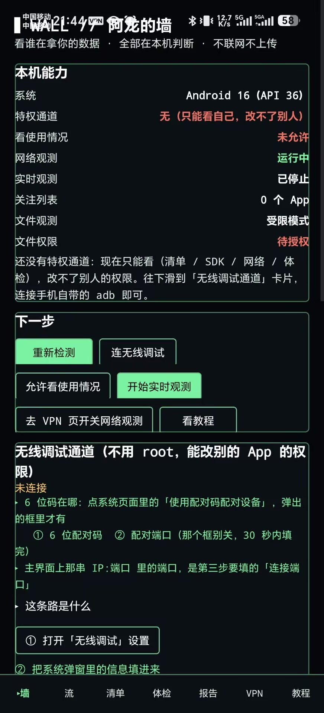
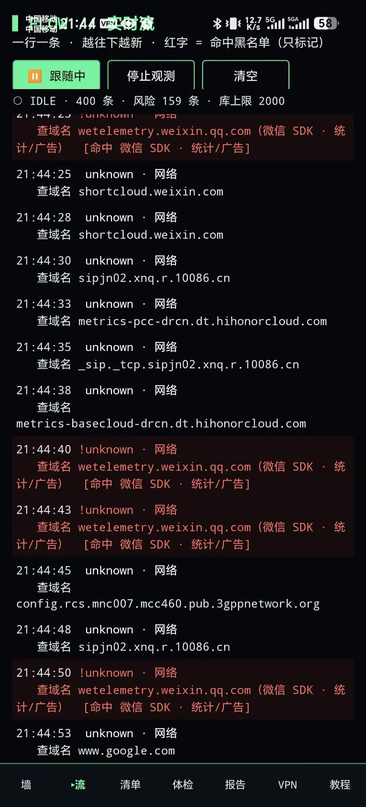
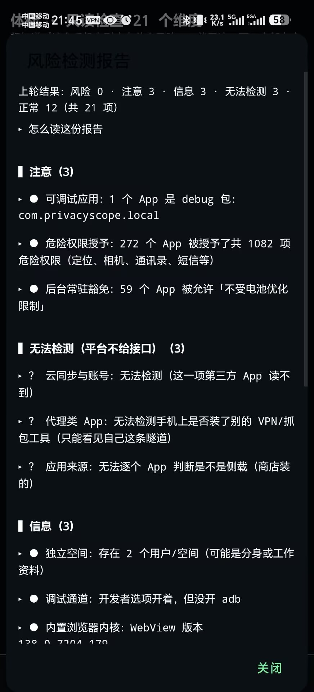
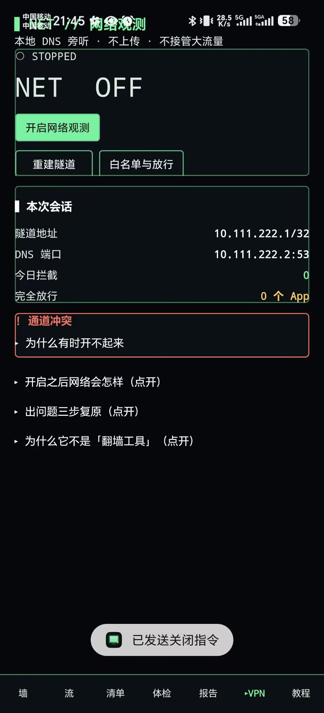

# DragonsWall · 阿龙的墙

**[简体中文](README.md) | English**

[](https://github.com/Y-steve-dragon/Dragons-wall/actions/workflows/android.yml)
[](LICENSE)
[-3ddc84.svg)](#requirements--build)
[](#requirements--build)
[](#privacy)
[](https://github.com/Y-steve-dragon/Dragons-wall/releases/latest)

**See what apps on your phone actually ask for and actually send out — and switch some of it off, without root. Everything happens on the device.**

- No network calls to any server, no accounts, no analytics SDK, no ads.
- Every decision is made locally from data the OS already exposes (`/proc`, `dumpsys appops`, `PackageManager`).
- It is **not** an antivirus, and it does not impersonate one: no fake device identifiers, no traffic interception of third parties, no evasion of other apps' safety checks.

> The name: the author's dorm nickname is "阿龙" (A-Long); "墙" means wall — a firewall that keeps what shouldn't leave, inside.

## Screenshots

| Wall · device capabilities | Stream · per-app DNS attribution |
|---|---|
|  |  |

| Checkup · 21 read-only checks | VPN · tunnel state |
|---|---|
|  |  |

## 60-second quick start

1. Download the APK from [Releases](https://github.com/Y-steve-dragon/Dragons-wall/releases/latest) and install it (you will need to allow "install unknown apps").
2. Open **Apps** (清单): every installed app with its permission count, dangerous-permission count, detected third-party SDKs and a risk score. Tap one to see its exported receivers / services / providers / activities.
3. To change another app's permissions, open **Wall** (墙) → **Wireless debugging channel**, pair once (Android 11+ ships its own `adbd`; **no root, no extra app**).

## What it does

| Module | What it does | Needs |
|---|---|---|
| App list | Installed apps, permissions, dangerous-permission count, third-party SDK labels, risk score; per-app detail with receivers / services / providers / activities, each marked "exported" or "internal" | — |
| Live stream | Takes over local DNS through `VpnService`, attributes each query to the app that made it, highlights domains that match the tracker/ad library | — (loopback only) |
| Wall (blocking) | Sinkholes tracker domains, per-app domain blocking, allowlists, and a bypass list that keeps chosen apps entirely outside the tunnel | — |
| Capability control | Switches AppOps capabilities off — device identifiers, background run, boot start, clipboard, location and more — with a before-snapshot and one-tap restore | Wireless-debugging channel (Android 11+) |
| Wireless-debugging channel | Talks to the phone's own `adbd` (`uid 2000`) and runs whitelisted `appops` / `pm` commands locally | Android 11+ |
| File watch | Shows new or modified files in public storage (restricted mode via MediaStore / full mode via direct walk) | Full mode needs "All files access" |
| Checkup | 21 read-only checks (patch level, test-keys, accessibility services, device admins, global proxy, …), each with *what I saw / why it matters / what you can do* | — |

## What it does **not** do

1. **No impersonation** — it never fakes device identifiers, location or model. That pollutes system state and is deception.
2. **No auditing of other people** — it only reads the device it is installed on.
3. **No evading detection** — it does not hide itself or fight anti-debugging. Other apps noticing "a VPN is up" is a legitimate outcome.
4. **Not a packet-level firewall** — blocking happens at the DNS layer. An app connecting to a hard-coded IP will not be blocked, and there is no "cut this app off completely" mode (that needs a user-space TCP/IP stack).
5. **No GPL code** — every third-party dependency is Apache-2.0, MIT or BSD.

## Known limitations (including the security boundary of the adb channel)

**Read this section first.** Item 1 in particular is an inherent cost of this approach, not a bug.

### The wireless-debugging channel

1. **It exposes the phone's `adbd` (`uid 2000` shell) on the current network.** With wireless debugging on, every device on the same Wi-Fi gains a reachable target it can probe and try to pair with. This channel is meant to be a window of tens of seconds, **not a permanently open door**.
   - Since v0.9.17 the UI shows **how long the channel has been connected** (turns red past 10 minutes) and **what kind of network you are on** (open network / public hotspot / encrypted / cellular-only);
   - The app deliberately **does not** flip the system's wireless-debugging switch for you. Writing system settings is out of scope; you close it yourself.
2. **Unpaired devices cannot connect.** Android 11+ requires pairing first (SPAKE2 plus the 6-digit code shown on screen); unpaired connections are rejected. The pairing private key lives in the app's private directory (`filesDir/adbkey/adbkey.pem`) and never leaves the device.
3. **Usually unavailable on cellular only.** Most devices require WLAN for wireless debugging, so the channel drops on mobile data. All **read-only** features (app list, live DNS stream, checkup, report) keep working; only "change another app's capabilities" needs Wi-Fi.
4. **Reconnect after reboot** — most devices turn wireless debugging off. The pairing key survives, so you usually do not need to pair again, but the connection port changes every time.
5. **Capabilities differ by OS version.** Not every AppOps name exists on every Android release (e.g. `GET_INSTALLED_APPS` is gone on Android 16). The UI then says "this system does not expose this capability" rather than pretending it failed.

### Everything else

- **Blocking is DNS-layer only** — apps using hard-coded IPs or their own DoH/DoT resolver are not blocked.
- **No per-app kill switch** — that needs a user-space TCP/IP stack, which this project does not implement.
- **No root support** — no root-only capability is provided or read.


## Requirements & build

| Item | Version |
|---|---|
| JDK | 17 |
| Android SDK | platform 36 / build-tools 36.0.0 |
| Gradle | 8.14.3 (wrapper included) |
| AGP / Kotlin | 8.13.2 / 2.3.20 |
| minSdk / targetSdk | 24 / 36 |

```bash
# local.properties (do not commit)
sdk.dir=/path/to/android-sdk

# Unit tests: 21 pure-logic tests, no device or emulator needed
./gradlew testDebugUnitTest

# Build
./gradlew assembleDebug     # app/build/outputs/apk/debug/app-debug.apk
./gradlew assembleRelease   # needs keys/keystore.properties (see .gitignore)
```

The first build downloads dependencies (AGP, Kotlin, Kadb). On Windows with non-ASCII paths, use `scripts/test.ps1` for the unit tests.

## Permissions (each one maps to a visible button; none is requested silently)

| Permission | Why |
|---|---|
| `QUERY_ALL_PACKAGES` | List installed apps — the app list page is built on it |
| `PACKAGE_USAGE_STATS` | Read when an app was last used (granted manually in system settings) |
| `INTERNET` / `ACCESS_NETWORK_STATE` | **Only** for the local `VpnService` loopback and network state; no outbound requests |
| `FOREGROUND_SERVICE` (+`SPECIAL_USE`) | The observation session must keep a notification, otherwise the system kills it |
| `POST_NOTIFICATIONS` | Show that notification |
| `MANAGE_EXTERNAL_STORAGE` | Full file-watch mode (optional; restricted mode is the default) |
| `READ_MEDIA_*` | Restricted mode watches the photo/audio/video collections only |

## Privacy

- There is no code path that sends anything to an external server; DNS observation and sinkholing complete on loopback.
- All data lives in a private SQLite database (`privacy.db`) inside the app sandbox and disappears on uninstall.
- No crash reporting, no anonymous stats. Exceptions are written to `filesDir/logs/` on the device only.

## Repository layout

```
app/src/main/java/com/privacyscope/local/
├── core/   Adb, AppOps, Blocker, Bypass, FileWatch, Monitor, Ops, PermZh, PkgRepo,
│           Pure (pure logic, unit-tested), Quiet (exception log), RiskDb, RiskScan,
│           Scanner, Shell, Store, TrackerDb, WatchList
├── vpn/    VpnService, DNS parse/forward/sinkhole, connection attribution
├── ui/     MainActivity + seven views + widget helpers (all code, no XML layouts)
└── res/    raw/risk_domains.txt (tracker / ad domain list)
app/src/test/  21 JVM unit tests
scripts/       test.ps1 (works around a Gradle worker issue on non-ASCII paths)
```

## Known limitations

- DNS-layer blocking only: DoH/DoT resolvers, hard-coded IPs and non-HTTP protocols bypass it.
- The wireless-debugging channel must be re-connected after a reboot or after toggling wireless debugging (the port changes); pairing itself does not have to be redone.
- Some AppOps names do not exist on every Android version; the UI reports "this system does not expose this capability" instead of failing silently.

## License

Apache License 2.0 — see [LICENSE](LICENSE). Third-party components and their licenses: [THIRD-PARTY.md](THIRD-PARTY.md). Changelog: [CHANGELOG.md](CHANGELOG.md).
