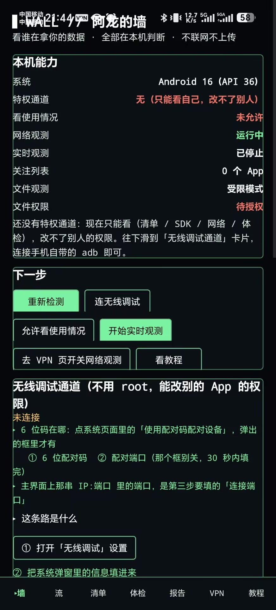
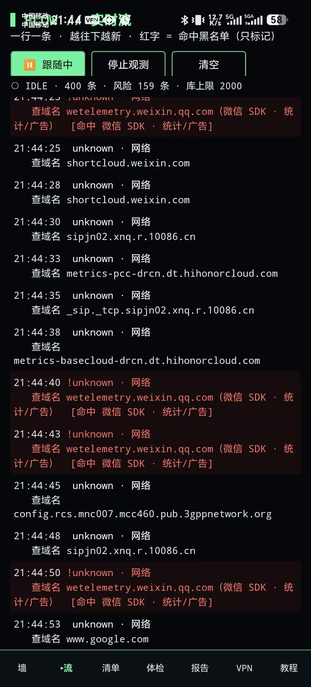
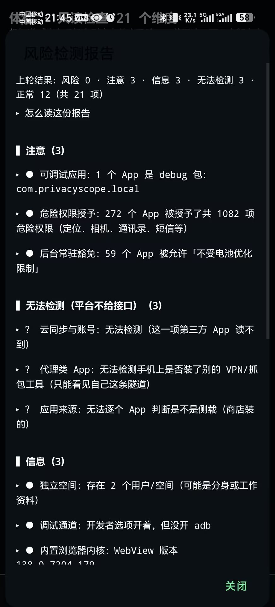
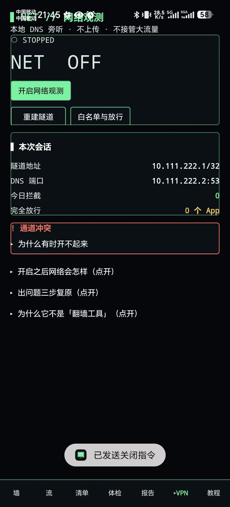

# 阿龙的墙 · DragonsWall

**简体中文 | [English](README.en.md)**

**看得见 App 在拿什么、发了哪些请求，并且能在不 root 的前提下关掉一部分。全部在本机完成。**

[](https://github.com/Y-steve-dragon/Dragons-wall/actions/workflows/android.yml)
[](LICENSE)
[-3ddc84.svg)](#环境与构建)
[](#环境与构建)
[](#隐私声明)
[](https://github.com/Y-steve-dragon/Dragons-wall/releases/latest)

- 不联网、不上传、没有账号、没有统计 SDK。
- 判断规则全部写在安装包里，读的是系统自己的记录（`/proc`、`dumpsys appops`、`PackageManager`）。
- 不是杀毒软件，也**不冒充**任何东西：不伪造设备信息、不劫持他人流量、不规避应用的安全检测。

> 名字来历：作者宿舍外号“阿龙”，“墙”指防火墙——把不该出去的东西挡在本地。

## 界面

| 墙 · 本机能力 | 流 · DNS 归因 |
|---|---|
|  |  |

| 体检 · 21 维度报告 | VPN · 隧道状态 |
|---|---|
|  |  |

## 三十秒上手

1. 去 [Releases](https://github.com/Y-steve-dragon/Dragons-wall/releases/latest) 下载 APK 安装（允许「安装未知来源应用」）。
2. 打开 App →「清单」页：看到本机所有 App 的权限数量、内置第三方 SDK 与风险分。
3. 想改别的 App 的权限 →「墙」页 →「无线调试通道」→ 按提示配对（Android 11+ 自带 adbd，**不需要 root、不需要装第三方 App**）。

## 它做什么

| 模块 | 做什么 | 依赖 |
|---|---|---|
| 清单 | 已安装 App、权限、危险权限数、内置第三方 SDK 标签与风险分；点开看它声明的广播/服务/内容提供者/页面，并标出哪些是「对外暴露」的 | 无 |
| 实时流 | 接管本机 DNS（VpnService），把每个域名请求按 App 归因，命中追踪器/广告库的整行标黄 | 无（仅本机回环） |
| 墙（拦截） | 按域名沉洞、按 App 屏蔽域名、白名单、完全放行名单；拦截记录逐条可查 | 无 |
| 权限收敛 | 用 AppOps 关掉「设备标识 / 后台运行 / 开机自启 / 剪贴板 / 定位」等能力，改前有快照、可回滚 | 无线调试通道（Android 11+） |
| 无线调试通道 | 连上手机自带的 adbd（uid 2000），在本机执行白名单内的 `appops` / `pm` 命令 | Android 11+ |
| 文件观测 | 看公共目录里哪些文件被新建或改动（受限模式走 MediaStore / 全盘模式走直接遍历） | 全盘模式需「所有文件访问」 |
| 体检 | 21 个维度只读检查（补丁天数、test-keys、无障碍、设备管理、全局代理…），每条给「看到了什么/凭什么/你能做什么」 | 无 |

## 它不做什么（写在最前面，避免误解）

1. **不伪造**设备信息、位置、机型号——那会污染系统状态，属于欺骗。
2. **不审计他人**：只能看本机；不提供任何针对他人设备的采集能力。
3. **不绕检测**：不隐藏自身、不反调试；被别的 App 检测到“有 VPN”是正常结果。
4. **不是包级防火墙**：拦截发生在域名（DNS）层，App 直接用 IP 连接则拦不住；也不是「单 App 完全断网」（那需要用户态 TCP/IP 协议栈）。
5. **不引 GPL**：所有第三方依赖均为 Apache-2.0 / MIT / BSD，可商用，不传染。

## 环境与构建

| 项 | 版本 |
|---|---|
| JDK | 17 |
| Android SDK | platform 36 / build-tools 36.0.0 |
| Gradle | 8.14.3（自带 Wrapper） |
| AGP / Kotlin | 8.13.2 / 2.3.20 |
| minSdk / targetSdk | 24 / 36 |

```bash
# local.properties（不要提交）
sdk.dir=/path/to/android-sdk

# 纯逻辑单测：21 条，不需要真机/模拟器
./gradlew testDebugUnitTest

# 构建
./gradlew assembleDebug     # app/build/outputs/apk/debug/app-debug.apk
./gradlew assembleRelease   # 需要 keys/keystore.properties，见 .gitignore
```

首次构建需联网下载依赖（AGP、Kotlin、Kadb）。Windows 中文路径下跑单测可用仓库里的 `scripts/test.ps1`。

## 权限说明（每一项都对应一个功能，没有多余项）

| 权限 | 为什么 |
|---|---|
| `QUERY_ALL_PACKAGES` | 列出已安装 App —— 「清单」页的前提 |
| `PACKAGE_USAGE_STATS` | 读某 App 最近被使用的时间（需用户在系统设置里手动授权） |
| `INTERNET` / `ACCESS_NETWORK_STATE` | **仅**用于本地 VpnService 回环与读取网络状态，不发起任何外部请求 |
| `FOREGROUND_SERVICE`(+`SPECIAL_USE`) | 观测运行时必须在通知栏常驻，否则被系统杀 |
| `POST_NOTIFICATIONS` | 显示那条常驻通知 |
| `MANAGE_EXTERNAL_STORAGE` | 全盘文件观测模式（可不开，默认受限模式） |
| `READ_MEDIA_*` | 受限模式下看相册/音频/视频目录的变化 |

> 没有“后台静默申请”的权限：以上每一项都对应界面上一个按钮，用户不点就不生效。

## 隐私声明

- 没有指向外部服务器的网络请求代码路径；DNS 观测与拦截都在本机回环完成。
- 数据存在 App 私有目录的 SQLite（`privacy.db`）里，卸载即删。
- 不收集崩溃日志、不做匿名统计；异常只写在本机 `filesDir/logs/`。

## 目录结构

```
app/src/main/java/com/privacyscope/local/
├── core/   Adb、AppOps、Blocker、Bypass、FileWatch、Monitor、Ops、PermZh、PkgRepo、
│           Pure(纯逻辑，可单测)、Quiet(异常记录)、RiskDb、RiskScan、Scanner、
│           Shell、Store、TrackerDb、WatchList
├── vpn/    VpnService、DNS 解析/转发/沉洞、连接归因
├── ui/     MainActivity + 七个视图 + 组件库（全代码，无 XML 布局）
└── res/    raw/risk_domains.txt（追踪器与广告域名库）
app/src/test/  21 条 JVM 单测
scripts/       test.ps1（中文路径下绕开 Gradle worker 问题的测试脚本）
```

## English

**DragonsWall** is a local-only Android privacy auditor. It lists installed apps with their permissions and third-party SDKs, attributes DNS queries to the app that made them (via `VpnService`, no traffic leaves the device), sinks known tracker domains, and lets you switch AppOps capabilities off through the phone's own wireless-debugging adbd — **no root required**. It never phones home, never fakes device data, and does not try to evade other apps' detection.

## 许可证

Apache License 2.0，见 [LICENSE](LICENSE)。第三方依赖及其许可证见 [THIRD-PARTY.md](THIRD-PARTY.md)。变更记录见 [CHANGELOG.md](CHANGELOG.md)。
